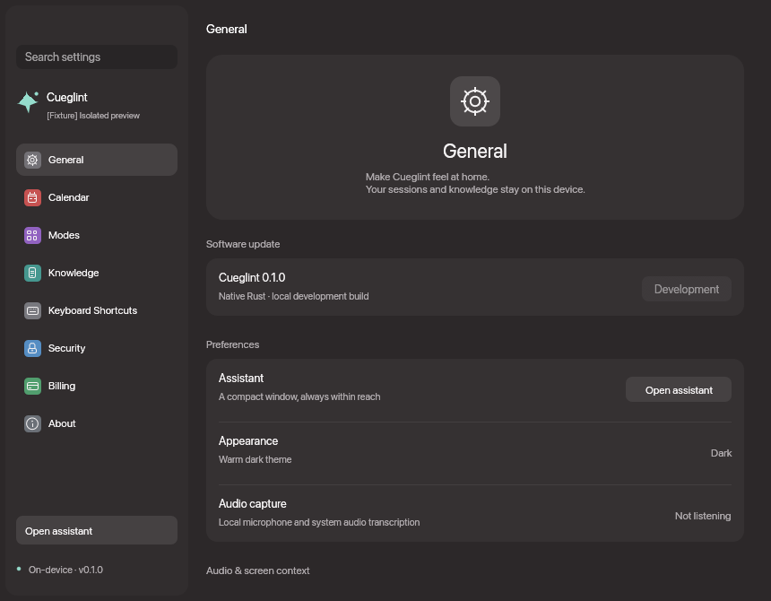

# Cueglint

**Your context. Your assistant. Your machine.**

A free, open-source desktop assistant written in Rust. Cueglint is reconstructing the
useful desktop workflows and measured interface of a pinned Cluely build, using independent
code, original branding, local data and optional local models.

**Early development; desktop parity is not established.** The native settings window,
floating assistant, local sessions/history/notes, modes, text knowledge, exports and CLI
work. Pinned models download with integrity checks and real local answers stream without
a hosted backend. Qwen 1.5B and Whisper base.en are the development defaults. Narrow
[original text checks](parity/reports/local-inference-candidates-v3.json) passed; the old
ASR waveform has been [retired](parity/reports/asr-fixture-retirement-001.json) for licensing.
Its separately versioned licensed replacement [failed the first accuracy check](parity/reports/redistributable-speech-v2-asr-001.json).
Earlier small-model [quality failures](parity/reports/local-inference-smoke.json) remain visible.
Live device capture, screen/OCR and complete offline acceptance still need controlled runtime verification.




These are native wgpu executable captures with labelled original fixtures. The compact
capture uses the same component in a primary test window because eframe's child viewport
readback is unavailable. Real child-window interaction is checked separately; neither image
is a matched reference comparison or evidence of real inference.

## Build and run

Rust 1.94.1 and the platform's native build tools are required. The desktop uses
eframe/egui 0.35 on wgpu; no Electron, webview, Node or Python runtime is required.

```sh
cargo run --release -p cueglint
cargo run --release -p cueglint-cli -- --help
cargo test --workspace
cargo xtask progress
cargo xtask inference-bench --models-dir /path/to/installed/models --report /tmp/local-model-check.json
cargo xtask package
```

The default launch opens the compact assistant; `--settings` opens Settings directly.
Install the listed profiles through General settings or the CLI's `models install` command.
Only explicit model installation uses the download service; model loading and inference are
local. Audio sources and screen context are visible controls. Missing models fail clearly.
The database currently has one process owner: close Cueglint before using its data through
the CLI. `CUEGLINT_DATA_DIR` and `CUEGLINT_MODEL_DIR` support isolated development runs.

The CLI and desktop share the same local core. Model availability, capture support and
verification limitations are recorded in [STATUS.md](STATUS.md), [models](docs/models.md)
and the [platform matrix](docs/platform-support.md). Model weights have their own licenses.

## Progress and scope

The first release target is the complete desktop workflow, including microphone **and**
system audio, local transcription, current screen context, streamed contextual answers,
session saving, notes/history, modes, knowledge, settings and observed integrations.
Mobile, browser, self-hosted sharing and sync remain separate inventoried tracks.

[Generated progress](docs/progress.md) and the [public dashboard](docs/dashboard/index.html)
come from [parity/features.yaml](parity/features.yaml). Observation, implementation and
verification are separate. Passing unit tests and fixture screenshots are not reference
parity or proof of real inference. [ROADMAP.md](ROADMAP.md) preserves the complete target.

Reference baseline: Cluely macOS 2.1.28, observed with an existing Pro account; remote
renderer/model/service versions remain unknown. Raw commercial packages, recovered code, account material and
personal captures are kept outside this public repository. See the
[research method](docs/research-method.md) and [verification process](docs/verification.md).

Newly authored code is dual licensed **MIT OR Apache-2.0**. See [CONTRIBUTING.md](CONTRIBUTING.md).
The synthetic v2 speech fixture has separate GPL-3.0-or-later terms in [THIRD_PARTY.md](THIRD_PARTY.md).
