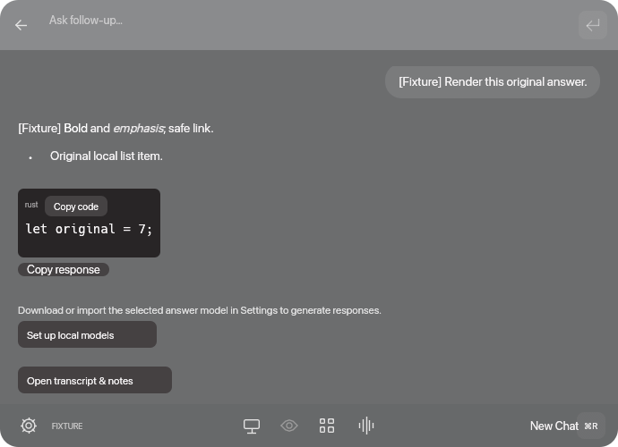

<picture>
  <source media="(prefers-color-scheme: dark)" srcset="ui/brand/cueglint-logo-inverse.svg">
  
</picture>

# Cueglint

**Your context. Your assistant. Your machine.**

A free, open-source desktop assistant written in Rust. Cueglint is reconstructing the
useful desktop workflows and measured interface of a pinned Cluely build, using independent
code, original branding, local data and optional local models.

Optional answer providers now include **OpenAI, Anthropic, Gemini, Perplexity,
OpenRouter and an OpenAI-compatible server**. General settings lets you enter a key,
choose a model and explicitly use that provider; local models remain the default.
Keys use native credential storage on macOS/Windows. Custom compatible endpoints can
connect to self-hosted or open-model servers. [Provider setup](docs/providers.md) explains
which context is sent, connection tests, costs and current verification limits.
All six protocols have controlled integration tests; live vendor accounts and actual
Ollama/LM Studio interoperability remain unverified.


This native executable capture shows an inactive compatible-provider draft. It uses
original fixed data, performs no network or credential operation, and is not a live
vendor or reference-parity test.

**Early development; desktop parity is not established.** The native settings window,
floating assistant, local sessions/history/notes, modes, text knowledge, exports and CLI
work. Pinned models download with integrity checks and real local answers stream without
a hosted backend. Qwen 1.5B and Whisper base.en are the development defaults. Narrow
[original text checks](parity/reports/local-inference-candidates-v3.json) passed; the old
ASR waveform has been [retired](parity/reports/asr-fixture-retirement-001.json) for licensing.
Its licensed replacement still [fails the fixed accuracy limit](parity/reports/whisper-frontend-v2-asr-001.json)
after the numerical frontend correction (WER 0.30; realtime criterion passed).
Earlier small-model [quality failures](parity/reports/local-inference-smoke.json) remain visible.
A [12-speaker English file check](parity/reports/human-asr-cpu-actual-002.json) passed for
base.en (10/279 word errors, every measured RTF≤1). Small.en was more accurate but failed
speed; the complete research suite failed. Live dual-source capture, corrected screen
selection and full offline acceptance still need controlled runtime verification.




These are native wgpu executable captures with labelled original fixtures. The compact
capture uses the same component in a primary test window because eframe's child viewport
readback is unavailable. Real child-window interaction remains a separate check. These images
are not matched reference comparisons or evidence of real inference.
All six fixtures passed in the [local native run](parity/reports/native-runtime-captures-002.json)
at source `bf1d373`. These GPU readbacks preserve the panel alpha; their appearance over
other windows, native backdrop blur and capture exclusion need separate OS checks.
The [first checkpoint](parity/reports/native-ui-checkpoint.json) and failed hosted runs
remain preserved. The later [hosted native run](parity/reports/native-fixture-ci-004.json)
passed all six captures and separate native child startup; it does not establish matched parity.

## Build and run

Rust 1.94.1 and the platform's native build tools are required. The desktop uses
eframe/egui 0.35 on wgpu; no Electron, webview, Node or Python runtime is required.

```sh
cargo run --release -p cueglint
cargo run --release -p cueglint-cli -- --help
cargo test --workspace
cargo xtask progress
cargo xtask inference-bench --models-dir /path/to/installed/models --report /tmp/local-model-check.json
cargo xtask package
```

The original [Cueglint logo](ui/brand/README.md) has transparent vector/raster exports and a
native app icon. Compact/chat surfaces use translucent tint layers; reference blur and
alpha remain unmeasured. History/notes retain their dark reading surfaces.

Assistant answers render native Markdown, including lists, code blocks and explicit web
links; copying preserves the full source. Histories above16 replies currently use
Earlier/Later/Latest controls. Native selection, full long-content fidelity and reference
visual comparisons remain open. See the [content contract](spec/features/native-answer-content.md).

Stopped meetings also offer explicit local **Highlights**: review selected original
utterances, accept or discard them, then append with a revision check that protects
manual notes. This is extractive highlighting; model salience quality and automatic
summaries/decisions/action items remain unverified. [Details](docs/generated-highlights-integration.md).

The default launch opens the compact assistant; `--settings` opens Settings directly.
Install or import the listed profiles through General settings or the CLI's `models`
commands. Removing local model copies preserves meetings, notes and source folders.
Only explicit model installation uses the download service. Local model loading/inference
stay local; a deliberately selected remote provider receives questions and selected context.
Audio sources and screen context are visible controls. Missing models fail clearly and never
activate a hosted fallback.
The database currently has one process owner: close Cueglint before using its data through
the CLI. `CUEGLINT_DATA_DIR` and `CUEGLINT_MODEL_DIR` support isolated development runs.

The CLI and desktop share the same local core. Model availability, capture support and
verification limitations are recorded in [STATUS.md](STATUS.md), [models](docs/models.md)
and the [platform matrix](docs/platform-support.md). Model weights have their own licenses.

## Progress and scope

The first release target is the complete desktop workflow, including microphone **and**
system audio, local transcription, current screen context, streamed contextual answers,
session saving, notes/history, modes, knowledge, settings and observed integrations.
Mobile, browser, self-hosted sharing and sync remain separate inventoried tracks.

[Generated progress](docs/progress.md) and the [public dashboard](docs/dashboard/index.html)
come from [parity/features.yaml](parity/features.yaml). Observation, implementation and
verification are separate. Passing unit tests and fixture screenshots are not reference
parity or proof of real inference. [ROADMAP.md](ROADMAP.md) preserves the complete target.

Reference baseline: Cluely macOS 2.1.28, observed with an existing Pro account; remote
renderer/model/service versions remain unknown. Raw commercial packages, recovered code, account material and
personal captures are kept outside this public repository. See the
[research method](docs/research-method.md) and [verification process](docs/verification.md).

Newly authored code is dual licensed **MIT OR Apache-2.0**. See [CONTRIBUTING.md](CONTRIBUTING.md).
The synthetic v2 speech fixture has separate GPL-3.0-or-later terms in [THIRD_PARTY.md](THIRD_PARTY.md).
