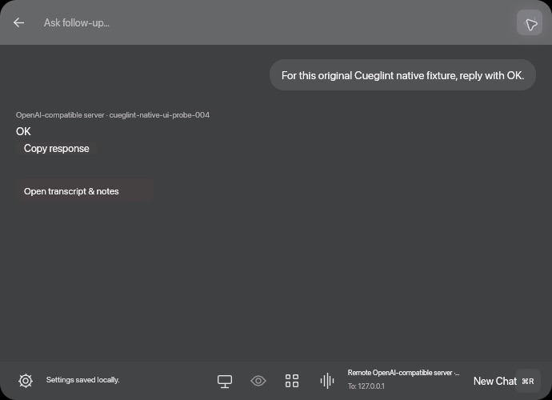
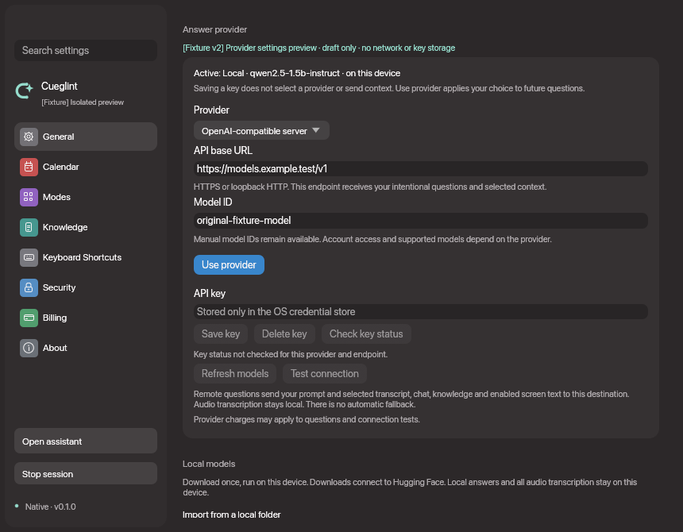
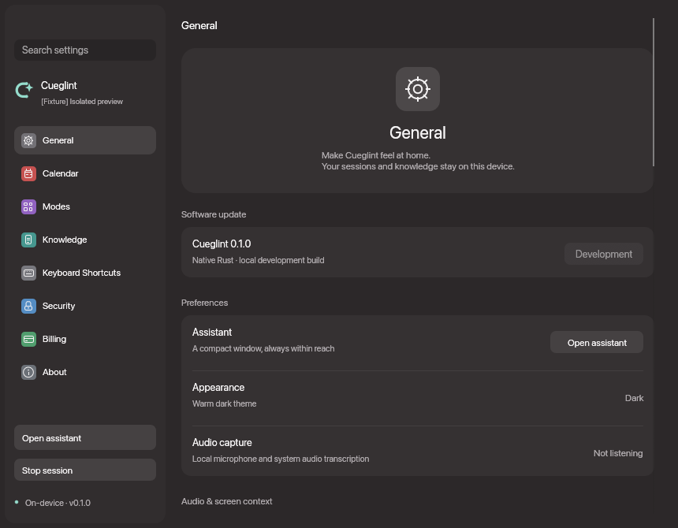
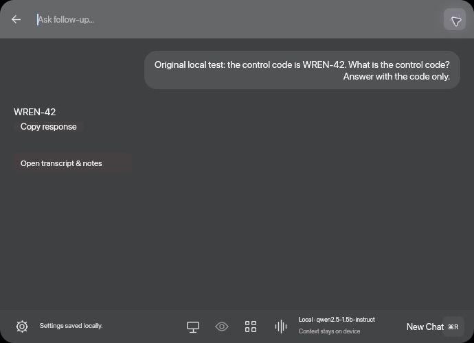
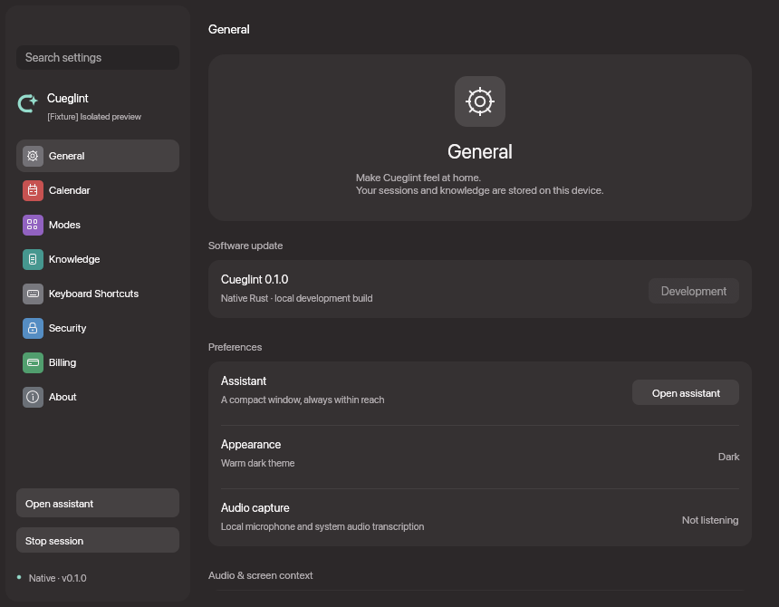
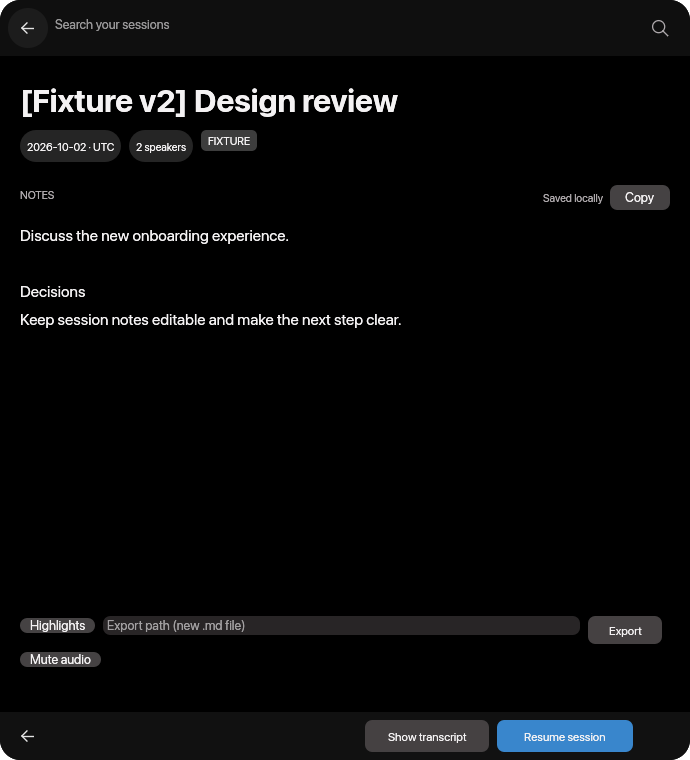

<picture>
  <source media="(prefers-color-scheme: dark)" srcset="ui/brand/cueglint-logo-inverse.svg">
  
</picture>

# Cueglint

**Your context. Your assistant. Your machine.**

A free, open-source desktop assistant written in Rust. Cueglint is reconstructing the
useful desktop workflows and measured interface of a pinned Cluely build, using independent
code, original branding, local data and optional local models.

Optional answer providers now include **OpenAI, Anthropic, Gemini, Perplexity,
OpenRouter and an OpenAI-compatible server**. General settings lets you enter a key,
choose a model and explicitly use that provider; local models remain the default.
Keys use native credential storage on macOS/Windows. Custom compatible endpoints can
connect to self-hosted or open-model servers. [Provider setup](docs/providers.md) explains
which context is sent, connection tests, costs and current verification limits.
All six protocols have controlled integration tests. The packaged CLI also passed a
[real local Qwen/llama.cpp check](parity/reports/optional-llama-interop-004-actual-evaluation.json):
one original question repeated twice, with independently reviewed answers and persisted
context. Live vendor accounts and actual Ollama/LM Studio interoperability remain unverified.
The [native macOS provider check](parity/reports/native-provider-ui-004.json)
also exercises scoped key save/delete, model listing, an explicit connection test,
provider switching and one floating-assistant question against a synthetic loopback
server. This verifies the native route, not a vendor account or model quality.



This is the running macOS assistant after an intentional provider selection. The
original test server returns `OK`; this capture is not evidence of model quality.



This native executable capture shows an inactive compatible-provider draft. It uses
original fixed data, performs no network or credential operation, and is not a live
vendor or reference-parity test.

**Early development; desktop parity is not established.** The native settings window,
floating assistant, local sessions/history/notes, modes, bounded document knowledge, exports and CLI
work. Pinned models download with integrity checks and real local answers stream without
a hosted backend. Qwen 1.5B and Whisper base.en are the development defaults. Narrow
[original text checks](parity/reports/local-inference-candidates-v3.json) passed; the old
ASR waveform has been [retired](parity/reports/asr-fixture-retirement-001.json) for licensing.
Its licensed replacement still [fails the fixed accuracy limit](parity/reports/whisper-frontend-v2-asr-001.json)
after the numerical frontend correction (WER 0.30; realtime criterion passed).
Earlier small-model [quality failures](parity/reports/local-inference-smoke.json) remain visible.

Knowledge imports support UTF-8 text, Markdown, main-body **DOCX** and a strict
text-based **PDF** profile, up to 2 MiB. The shared Rust path preserves notes,
retrieval offsets, deletion and backups. [PDF implementation checks](parity/reports/knowledge-pdf-targeted-runtime-001.json)
pass six named CLI document tests and a separate native supervision self-check.
The native child has a ten-second parent deadline and a 256 MiB cumulative Rust
allocation-work budget; this is not an RSS limit. [PDF limits](spec/features/native-knowledge-pdf.md)
exclude OCR/scans, forms/images, annotations and wider font/layout support.
Earlier [DOCX workspace checks](parity/reports/knowledge-docx-integrated-workspace-001.json)
and [retained PDF failures](parity/reports/knowledge-pdf-external-stream-red-001.json)
remain separate. The [integrated workspace](parity/reports/knowledge-pdf-integrated-workspace-001.json)
passes 339 tests with four explicit ignores and no failures/filtering, plus the
separate PDF supervision self-check. Headless normal-quit and import-start ordering
checks pass. The packaged macOS app imported, reopened and deleted an original
PDF while preserving the other document and its retrieval. Active-import quit
and matched reference checks remain open. [Native Knowledge results](parity/reports/native-knowledge-flow-001.json)

In **Modes**, turn off **Search all library files** to choose reference files.
**Use this mode** saves and activates a draft for the next conversation. Use
`cueglint-cli mode set-files MODE_ID DOCUMENT_ID` from the terminal. Give no
file IDs to exclude the library, or use `--all` to restore library-wide retrieval.
The packaged assistant used only the selected file for one real offline answer.
The run also checked deleting the last file, preserving the empty selection, and
exporting and restoring a scoped backup. [Mode scope results](parity/reports/native-mode-scope-001.json)
[Microphone PCM checks](parity/reports/microphone-pcm-runtime-001.json) exercise
all 12 typed CPAL frontend formats, preserve existing float32 mixing, and keep
bounded packet/error handling. The frozen staged workspace passes 376 tests;
actual backend/device formats and native capture still require verification.
General → Local models and the CLI now offer explicit **transcription language**
selection. Non-English input uses the optional pinned `whisper-base` profile; the
English defaults remain unchanged. [Language implementation checks](parity/reports/transcription-language-runtime-001.json)
pass ten new regressions inside a 386-test workspace, including persistence,
backup compatibility, native picker semantics and worker/session isolation. The
[Live macOS settings testing](parity/reports/native-language-pointer-002.json)
verified that selecting a language with the mouse saves it across quit and reopen.
A [packaged offline file check](parity/reports/packaged-multilingual-asr-001.json)
ran the pinned multilingual model. The authored English control passed and the
Portuguese sample failed its frozen accuracy threshold. The packaged macOS picker
passed arrow selection, Return, Escape and reopening. Live devices, broader
language quality, translation and UI localization remain open.
[Native keyboard checks](parity/reports/native-language-keyboard-004.json)
[Streaming resampling checks](parity/reports/audio-resampling-runtime-001.json)
preserve first/last16k samples, filter other rates and retain continuity across
packets and internal utterance cuts. Forty targeted checks and the frozen source's
353-test workspace pass; live devices, clock drift, echo and new ASR-quality
acceptance remain open.
A [12-speaker English file check](parity/reports/human-asr-cpu-actual-002.json) passed for
base.en (10/279 word errors, every measured RTF≤1). Small.en was more accurate but failed
speed; the complete research suite failed. Live dual-source capture, corrected screen
selection and full offline acceptance still need controlled runtime verification.




These two are native wgpu executable captures with labelled original fixtures. The compact
capture uses the same component in a primary test window because eframe's child viewport
readback is unavailable. Real child-window interaction remains a separate check. These images
are not matched reference comparisons or evidence of real inference.



The [native local text check](parity/reports/native-local-session-001.json) uses the
development-signed executable at `e4a4677` and verified Qwen1.5B/Candle CPU. One
original question returns its expected control code. A manual note survives End,
normal quit, JSON export and reopening from history. Audio and screen capture,
blocked-network operation and broad model quality remain separate open checks.

All six fixtures passed in the [local native run](parity/reports/native-runtime-captures-002.json)
at source `bf1d373`. These GPU readbacks preserve the panel alpha; their appearance over
other windows, native backdrop blur and capture exclusion need separate OS checks.
The latest [renderer/audio repair](parity/reports/desktop-repair-workspace-001.json)
passed253 workspace tests (three model/oracle ignores) and all 13 new primary-window
[native fixtures](parity/reports/native-desktop-repair-001.json), with request UUIDs and
GPU submission/readback evidence. The preceding source85 capture batch remains failed
(12/13); its original timeout cause is unknown.
The [first checkpoint](parity/reports/native-ui-checkpoint.json) and failed hosted runs
remain preserved. The later [hosted native run](parity/reports/native-fixture-ci-004.json)
passed all six captures and separate native child startup; it does not establish matched parity.

## Build and run

Rust 1.94.1 and the platform's native build tools are required. The desktop uses
eframe/egui 0.35 on wgpu; no Electron, webview, Node or Python runtime is required.

```sh
cargo run --release -p cueglint
cargo run --release -p cueglint-cli -- --help
cargo test --workspace
cargo xtask progress
cargo xtask inference-bench --models-dir /path/to/installed/models --report /tmp/local-model-check.json
cargo xtask package
```

The macOS arm64 packager creates an ad-hoc signed app and CLI with matching
third-party notice trees and SHA-256 checksums. An
[independently checked local build](parity/reports/macos-arm64-package-003.json)
verified both notice trees, checksums, signature integrity and CLI help.
Notarization, clean installation and other platform packages remain open.

The original [Cueglint logo](ui/brand/README.md) has transparent vector/raster exports and a
native app icon. Compact/chat surfaces use translucent tint layers; reference blur and
alpha remain unmeasured. History/notes retain their dark reading surfaces.

Assistant answers render native Markdown, including lists, code blocks and explicit web
links; copying preserves the full source. Histories above16 replies currently use
Earlier/Later/Latest controls. Native selection, full long-content fidelity and reference
visual comparisons remain open. See the [content contract](spec/features/native-answer-content.md).

Stopped meetings also offer explicit local **Highlights**: review selected original
utterances, accept or discard them, then append with a revision check that protects
manual notes. This is extractive highlighting; model salience quality and automatic
summaries/decisions/action items remain incomplete. The current
[third actual model evaluation](parity/reports/highlights-quality-actual-003.json)
still fails the fixed salience criteria with the revised prompt. Valid source-bound
output alone does not establish useful selection. [Details](docs/generated-highlights-integration.md).

The default launch opens the compact assistant; `--settings` opens Settings directly.
Install or import the listed profiles through General settings or the CLI's `models`
commands. Removing local model copies preserves meetings, notes and source folders.
Only explicit model installation uses the download service. Local model loading/inference
stay local; a deliberately selected remote provider receives questions and selected context.
Audio sources and screen context are visible controls. Missing models fail clearly and never
activate a hosted fallback.
The database currently has one process owner: close Cueglint before using its data through
the CLI. `CUEGLINT_DATA_DIR` and `CUEGLINT_MODEL_DIR` support isolated development runs.

The CLI and desktop share the same local core. Model availability, capture support and
verification limitations are recorded in [STATUS.md](STATUS.md), [models](docs/models.md)
and the [platform matrix](docs/platform-support.md). Model weights have their own licenses.

## Progress and scope

The first release target is the complete desktop workflow, including microphone **and**
system audio, local transcription, current screen context, streamed contextual answers,
session saving, notes/history, modes, knowledge, settings and observed integrations.
Mobile, browser, self-hosted sharing and sync remain separate inventoried tracks.

[Generated progress](docs/progress.md) and the [public dashboard](docs/dashboard/index.html)
come from [parity/features.yaml](parity/features.yaml). Observation, implementation and
verification are separate. Passing unit tests and fixture screenshots are not reference
parity or proof of real inference. [ROADMAP.md](ROADMAP.md) preserves the complete target.
The [active delivery goal](docs/delivery-goal.md) defines all eight workstreams and
twelve acceptance families; [STATUS.md](STATUS.md) records the exact resume point.
The PR22 runtime checkpoint `56d885c` passes [330 full workspace checks](parity/reports/model-download-phase-budgets-001.json)
in release mode, with zero failures/filtering and four explicit ignores.
[Merged PR23's independent hosted audit](parity/reports/pr23-hosted-ci-artifact-001.json)
records Windows/macOS 339 and Ubuntu 337 passes across 32 summaries each, with a
separate PDF supervision self-check on each platform. All thirteen original native
fixture frames and child startup pass; five cancellations remain retained. This is
implementation and fixture-rendering evidence, with native import/quit and package
notice bundling still open. The earlier [PR22 audit](parity/reports/pr22-hosted-ci-artifact-001.json)
remains separate.
[One actual CLI model-install recovery](parity/reports/model-install-recovery-001.json)
verifies all three optional 7B files without changing defaults. Its first eight-case
candidate attempt stopped in monitor preflight with zero CLI/model calls; 7B
initialization and quality remain unrun. The earlier [299-check checkpoint](parity/reports/local-reliability-workspace-001.json)
and failed checks remain retained. This is implementation evidence.

Reference baseline: Cluely macOS 2.1.28, observed with an existing Pro account; remote
renderer/model/service versions remain unknown. Raw commercial packages, recovered code, account material and
personal captures are kept outside this public repository. See the
[research method](docs/research-method.md) and [verification process](docs/verification.md).

Newly authored code is dual licensed **MIT OR Apache-2.0**. See [CONTRIBUTING.md](CONTRIBUTING.md).
The synthetic v2 speech fixture has separate GPL-3.0-or-later terms in [THIRD_PARTY.md](THIRD_PARTY.md).


Updated native fixtures at source `3e4cce4` wait for applied font definitions and a
completed UI pass. These are the working Rust executable with original stable content,
not reference comparisons. [Capture evidence](parity/reports/native-font-readiness-001.json).



